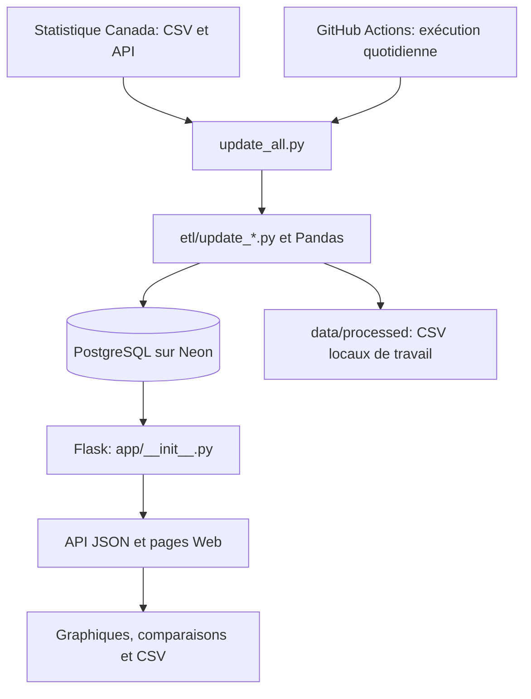

# Architecture / Architecture

## Français

### Objectif et choix techniques

La plateforme distingue le traitement des données de leur affichage. Les scripts Python récupèrent les tableaux officiels, Pandas normalise les colonnes et filtres, PostgreSQL conserve les observations, et Flask expose les résultats pour le tableau de bord. Neon fournit PostgreSQL hébergé; Render héberge l'application Web. GitHub Actions exécute l'ETL indépendamment de Render afin que la veille éventuelle du service Web n'empêche pas la planification.

### Composants du dépôt

| Élément | Rôle |
| --- | --- |
| `app/__init__.py` | Application Flask et routes Web/API |
| `app/templates/`, `app/static/` | Gabarits, styles et scripts de l'interface *(présents dans le projet déployé, non fournis dans l'archive de revue ETL)* |
| `etl/update_*.py` | Sélection et insertion des six tableaux |
| `etl/db.py` | Connexion PostgreSQL via `DATABASE_URL`, avec repli local hors Actions |
| `update_all.py` | Orchestration et téléchargement des grands tableaux |
| `data/raw/`, `data/processed/` | Fichiers intermédiaires générés lors de l'ETL |
| `tools/check_daily_update.py` | Comptages, dernières dates et recherche de doublons |
| `tools/validate_official.py` | Comparaison indépendante aux CSV officiels; configuration locale à adapter pour Neon |
| `tests/` | Tests de l'application et de l'orchestration |
| `.github/workflows/daily-update.yml` | Exécution planifiée/manuelle, contrôles et compte rendu |
| `sql/schema.sql` | Exemple de création d'une base neuve reproduisant les tables utiles |

### Routes constatées dans le code fourni

| Route | Fonction |
| --- | --- |
| `/` et `/dashboard` | Tableau de bord |
| `/about` et `/a-propos` | À propos |
| `/health` | État du service |
| `/api/overview` | Dernières observations |
| `/api/history/<dataset>` | Historique court |
| `/api/chart/<dataset>?range=1Y\|5Y\|10Y\|ALL` | Graphiques temporels |
| `/api/analytics/<dataset>` | Indicateurs descriptifs |
| `/api/regions/<dataset>` | Régions proposées |
| `/api/region-history/<dataset>` | Comparaison historique région/Canada |
| `/api/export/<dataset>?range=1Y&lang=fr` | Export CSV bilingue |

Les séries sont renvoyées au navigateur sous forme JSON; les calculs et les unités proviennent du code de l'application et de la base PostgreSQL. Les données ne sont pas intégrées en dur dans les graphiques.

---

## English

### Goal and design

Data processing is separate from presentation. Python downloads Statistics Canada files; Pandas filters and normalizes observations; PostgreSQL stores historical values; Flask serves JSON data and the bilingual dashboard. Neon hosts the database, Render hosts the website, and GitHub Actions refreshes the data independently of the web hosting process.

The diagram above shows the execution path. Key files include `update_all.py` (ETL orchestration), `etl/update_*.py` (per-table transforms and upserts), `etl/db.py` (database connection), `app/__init__.py` (Flask routes), `tools/check_daily_update.py` (integrity checks), `tests/` (tests) and `.github/workflows/daily-update.yml` (scheduler).

The API includes `/health`, `/api/overview`, `/api/history/<dataset>`, `/api/chart/<dataset>`, `/api/analytics/<dataset>`, `/api/regions/<dataset>`, `/api/region-history/<dataset>` and `/api/export/<dataset>`, plus the dashboard and about pages.

Data flows from the database through Flask as JSON or CSV rather than being hard-coded into the charts. Temporary raw and processed CSVs are generated by the ETL and are not substitutes for the production database.
